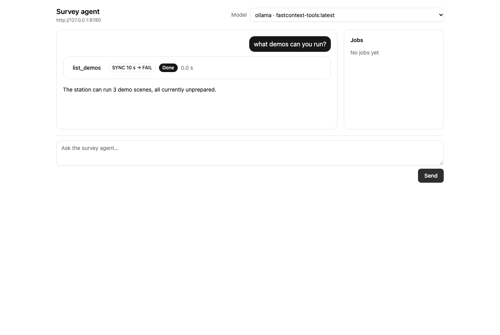

# Survey agent (`surmap.agent`)

A chat agent that runs the survey demos and inspects their results through
tools. The tools are a proto service: one codegen step compiles them, and a
contract builder turns every tool rpc into the contract a model binds —
name, description, JSON Schema arguments and default execution policy.

## Layout

| Path | What |
|---|---|
| `proto/surmap/agent/v1/execution.proto` | `default_execution` method option, `ExecutionPolicy`, `ExecutionMode`, `OnTimeout`, `JobHandle` |
| `proto/surmap/agent/v1/survey_tools.proto` | `SurveyTools` — demo, SAM, object and frame tools |
| `proto/surmap/agent/v1/map_tools.proto` | `MapTools` — place/move GLB shapes, navigate the camera, draw routes, load layers on the embedded map |
| `proto/surmap/agent/v1/fleet_tools.proto` | `FleetTools` — nests and drones of a running simulation, launch/route/detour/recall, the active drone, the fleet log (simulation only) |
| `proto/surmap/agent/v1/jobs.proto` | `AgentJobs` — follow and cancel detached tool calls |
| `proto/surmap/agent/v1/chat.proto` | `ChatService` — the browser's chat API (`StreamTurn`, `WatchConversation`, `Steer`, `CancelTurn`, `ListModels`, `GetConversation`), streaming `TurnEvent`s |
| `src/surmap/agent/proto/` | Generated `_pb2.py` / `.pyi` and `agent_descriptor_set.binpb` (checked in) |
| `src/surmap/agent/contracts.py` | `ToolContract`, `tool_contracts(service)`, `resolve_execution(contract, arguments)` |
| `src/surmap/agent/subagents.py` | `SubagentPool`, `SubagentSetup`, `subagent_tools` — delegated work in a context of its own (*Subagents*) |
| `src/surmap/agent/services.py` | `survey_tools_module`, `agent_jobs_module`, `chat_service_module`, `fleet_module` — `ServiceModule`s where an rpc with no handler answers `UNIMPLEMENTED` |

## Tool catalogue

A tool's name is its rpc in snake_case; its description is the rpc's
leading comment, and argument descriptions are the field comments.

| Tool | RPC | Default execution |
|---|---|---|
| `list_demos` | `SurveyTools.ListDemos` | SYNC · 10 s · FAIL |
| `list_onboard_models` | `SurveyTools.ListOnboardModels` | SYNC · 10 s · FAIL |
| `run_demo` | `SurveyTools.RunDemo` | SYNC · 30 s · DETACH |
| `get_run` | `SurveyTools.GetRun` | SYNC · 10 s · FAIL |
| `prompt_sam` | `SurveyTools.PromptSam` | SYNC · 60 s · DETACH |
| `find_objects` | `SurveyTools.FindObjects` | SYNC · 15 s · FAIL |
| `get_object` | `SurveyTools.GetObject` | SYNC · 10 s · FAIL |
| `get_object_geometry` | `SurveyTools.GetObjectGeometry` | SYNC · 15 s · FAIL |
| `get_frame` | `SurveyTools.GetFrame` | SYNC · 15 s · FAIL |
| `list_datasets` | `SurveyTools.ListDatasets` | SYNC · 10 s · FAIL |
| `get_dataset` | `SurveyTools.GetDataset` | SYNC · 10 s · FAIL |
| `prepare_dataset` | `SurveyTools.PrepareDataset` | SYNC · 30 s · DETACH |
| `run_rtabmap` | `SurveyTools.RunRtabmap` | SYNC · 30 s · DETACH |
| `get_station_status` | `StationTools.GetStationStatus` (with `--station`) | SYNC · 10 s · FAIL |
| `start_station` | `StationTools.StartStation` (with `--station`) | SYNC · 30 s · DETACH |
| `stop_station` | `StationTools.StopStation` (with `--station`) | SYNC · 30 s · DETACH |
| `run_sam_on_dataset` | `SurveyTools.RunSamOnDataset` | SYNC · 60 s · DETACH |
| `wait_for_jobs` | `AgentJobs.WaitForJobs` | SYNC · 300 s · FAIL |
| `get_job` | `AgentJobs.GetJob` | SYNC · 10 s · FAIL |
| `cancel_job` | `AgentJobs.CancelJob` | SYNC · 10 s · FAIL |
| `list_jobs` | `AgentJobs.ListJobs` | SYNC · 10 s · FAIL |
| `add_map_object` | `MapTools.AddMapObject` | SYNC · 10 s · FAIL |
| `move_map_object` | `MapTools.MoveMapObject` | SYNC · 10 s · FAIL |
| `remove_map_object` | `MapTools.RemoveMapObject` | SYNC · 10 s · FAIL |
| `list_map_objects` | `MapTools.ListMapObjects` | SYNC · 10 s · FAIL |
| `get_map_scene` | `MapTools.GetMapScene` | SYNC · 10 s · FAIL |
| `navigate_map` | `MapTools.NavigateMap` | SYNC · 10 s · FAIL |
| `show_route` | `MapTools.ShowRoute` | SYNC · 10 s · FAIL |
| `update_route` | `MapTools.UpdateRoute` | SYNC · 10 s · FAIL |
| `clear_route` | `MapTools.ClearRoute` | SYNC · 10 s · FAIL |
| `list_map_layers` | `MapTools.ListMapLayers` | SYNC · 10 s · FAIL |
| `load_map_layer` | `MapTools.LoadMapLayer` | SYNC · 10 s · FAIL |
| `unload_map_layer` | `MapTools.UnloadMapLayer` | SYNC · 10 s · FAIL |
| `search_assets` | `SimulationTools.SearchAssets` | SYNC · 20 s · FAIL |
| `download_asset` | `SimulationTools.DownloadAsset` | SYNC · 60 s · DETACH |
| `list_assets` | `SimulationTools.ListAssets` | SYNC · 10 s · FAIL |
| `create_scenario` | `SimulationTools.CreateScenario` | SYNC · 10 s · FAIL |
| `add_model` | `SimulationTools.AddModel` | SYNC · 10 s · FAIL |
| `add_element` | `SimulationTools.AddElement` | SYNC · 10 s · FAIL |
| `remove_element` | `SimulationTools.RemoveElement` | SYNC · 10 s · FAIL |
| `set_weather` | `SimulationTools.SetWeather` | SYNC · 10 s · FAIL |
| `add_fire` | `SimulationTools.AddFire` | SYNC · 10 s · FAIL |
| `remove_fire` | `SimulationTools.RemoveFire` | SYNC · 10 s · FAIL |
| `set_behaviour` | `SimulationTools.SetBehaviour` | SYNC · 10 s · FAIL |
| `update_behaviour_node` | `SimulationTools.UpdateBehaviourNode` | SYNC · 10 s · FAIL |
| `get_behaviour` | `SimulationTools.GetBehaviour` | SYNC · 10 s · FAIL |
| `list_building_presets` | `SimulationTools.ListBuildingPresets` | SYNC · 10 s · FAIL |
| `set_district` | `SimulationTools.SetDistrict` | SYNC · 10 s · FAIL |
| `remove_district` | `SimulationTools.RemoveDistrict` | SYNC · 10 s · FAIL |
| `style_building` | `SimulationTools.StyleBuilding` | SYNC · 10 s · FAIL |
| `add_building_fire` | `SimulationTools.AddBuildingFire` | SYNC · 10 s · FAIL |
| `remove_building_fire` | `SimulationTools.RemoveBuildingFire` | SYNC · 10 s · FAIL |
| `get_scenario` | `SimulationTools.GetScenario` | SYNC · 10 s · FAIL |
| `list_scenarios` | `SimulationTools.ListScenarios` | SYNC · 10 s · FAIL |
| `list_nests` | `FleetTools.ListNests` | SYNC · 10 s · FAIL |
| `list_drones` | `FleetTools.ListDrones` | SYNC · 10 s · FAIL |
| `launch_drone` | `FleetTools.LaunchDrone` | SYNC · 10 s · FAIL |
| `set_route` | `FleetTools.SetRoute` | SYNC · 10 s · FAIL |
| `add_detour` | `FleetTools.AddDetour` | SYNC · 10 s · FAIL |
| `recall_drone` | `FleetTools.RecallDrone` | SYNC · 10 s · FAIL |
| `set_active_drone` | `FleetTools.SetActiveDrone` | SYNC · 10 s · FAIL |
| `get_fleet_log` | `FleetTools.GetFleetLog` | SYNC · 10 s · FAIL |
| `drone_map_status` | `FleetTools.DroneMapStatus` | SYNC · 10 s · FAIL |
| `start_subagent` | — (`surmap.agent.subagents`) | SYNC · 10 s · FAIL |
| `message_subagent` | — (`surmap.agent.subagents`) | SYNC · 10 s · FAIL |
| `message_main_agent` | — (a subagent's only) | SYNC · 10 s · FAIL |

Every tool rpc must declare `option (default_execution)`;
`tool_contracts` refuses a service with an rpc that does not.

Schema rules: a singular field without presence is `required`; `optional`
fields, oneof members, messages and repeated fields are not; every object
has `additionalProperties: false`; enums are string enums without their
`*_UNSPECIFIED` value; 64-bit integers are JSON `integer`.

## The `execution` argument

Every tool schema gets one optional argument, `execution`, injected by the
contract builder rather than declared in each request message:

```json
{"execution": {"mode": "ASYNC", "timeout_s": 120, "on_timeout": "DETACH"}}
```

- `mode` — `SYNC` blocks the turn; `ASYNC` returns a `JobHandle` at once.
- `timeout_s` — how long a `SYNC` call may run.
- `on_timeout` — `FAIL` the call, or `DETACH` it to a job the model follows
  with `wait_for_jobs`.

`resolve_execution(contract, arguments)` returns the rpc's
`default_execution` with any field the model gave overriding it; an
invalid value is a `ValueError`. The runtime strips `execution` before
decoding the request.

## Tools (`surmap.agent.tools`)

`survey_tool_handlers(workspace)` maps every `SurveyTools` rpc to a handler over a
`SurveyWorkspace` port (`tools/port.py`). `DemoWorkspace` (`tools/workspace.py`) is the default
adapter: it drives the demo's `DemoRunHost` headlessly, reads its run history (so agent runs show
in the console) and publishes GLB through a `GeometryStore` (`tools/geometry.py`). Read/run only —
the one exception is the fleet tools below, which task the simulation's drones and never a real
aircraft.

| Tool | Arguments | Result | Default execution |
|---|---|---|---|
| `list_demos` | — | every scene: `id`, `title`, `default_prompt`, `prepared`, `cached_run_id` | SYNC · 10 s · FAIL |
| `list_onboard_models` | — | every on-board (Coral) model: `name`, `title`, `note`, `available` on this station, `is_default`, `classes` (the 80 COCO classes it can recognise); and `default_model` (`"none"` when runs default to no model) | SYNC · 10 s · FAIL |
| `run_demo` | `dataset`; `prompt` (scene default); `max_frames` (whole scene); `fps` (native, > 0); `onboard_model` (station default; `"none"` for no on-board model) | the ended run: `run_id`, frames, objects, `status`, `onboard_model`, `onboard_recognises_prompt` (absent without an on-board model) | SYNC · 30 s · DETACH |
| `get_run` | `run_id` | `RunInfo`: dataset, prompt, frames, objects, status, `onboard_model` (empty for none) | SYNC · 10 s · FAIL |
| `prompt_sam` | `run_id`, `concept`; `frame_ids` or `max_frames` (≤ 8) | per frame: `frame_id`, `t_ns`, detections with ids, label, score, box, mask polygon | SYNC · 60 s · DETACH |
| `find_objects` | `run_id`; `label`, `near` + `radius_m`, `moving`, `limit` | object summaries, nearest first with `near`, else largest first; no neighbours | SYNC · 15 s · FAIL |
| `get_object` | `run_id`, `object_id` | one summary with its nearest neighbours (5 m, 5 nearest) | SYNC · 10 s · FAIL |
| `get_object_geometry` | `run_id`, `object_id`; `max_points` (500), `voxel_m` | `surmap-obj v1` text and the GLB `geometry_uri` | SYNC · 15 s · FAIL |
| `get_frame` | `run_id`; `frame_index` / `frame_id` / `t_ns` (first frame); `crop_box` / `crop_object_id`; `pad_px`; `max_side` | one JPEG as image content, its size and `source` (`FULL` / `DISPLAY`) | SYNC · 15 s · FAIL |
| `list_datasets` | — | every gallery dataset: provider, licence, `GREY`/`COLOR` modality, prepared, frame count, thumbnail flag, location, GPS centre + downsampled track | SYNC · 10 s · FAIL |
| `get_dataset` | `dataset_id` | one `DatasetEntry` | SYNC · 10 s · FAIL |
| `prepare_dataset` | `dataset_id` | the prepared `DatasetEntry` | SYNC · 30 s · DETACH |
| `run_rtabmap` | `dataset`; `max_frames`; `fps`; `onboard_model` (as `run_demo`) | the recorded RTAB-Map-only run (`RunInfo`) | SYNC · 30 s · DETACH |

**On-board model choice** (`tools/onboard.py`). `OnboardModels` is the station's Coral profiles
(`surmap.detection.profiles`) in its prepared model dir; a profile is `available` when the dir holds
its CPU twin and `coco_labels.txt`. Each run resolves `onboard_model` — a profile name, `"none"`, or
absent for the station default — and builds its own detection source (fresh tracker state), which
replaces the host's `detection_source` for that run only. A name no profile has is
`INVALID_ARGUMENT`; a profile the station lacks is `FAILED_PRECONDITION` and records no run. The run
title carries ` · On-board: <model>` ahead of the SAM part, and `RunInfo.onboard_model` reads it back.

Every profile detects only the 80 COCO classes (`surmap.detection.COCO_CLASSES`): people and
vehicles, but not debris, buildings, collapsed buildings, boxes or fire, which only SAM finds.
`run_demo` says so per run: `onboard_recognises_prompt` is whether the on-board model has a class for
the SAM concept (a trailing plural `s` is ignored, so `cars` matches `car`).
| `run_sam_on_dataset` | `dataset`; `concept` (dataset default); `max_frames` (≤ 8) | per-frame SAM detections on the dataset itself, no run | SYNC · 60 s · DETACH |

## Dataset gallery

The chat page's gallery and the dataset tools read one catalogue
(`surmap.demo.gallery.gallery_entries` over `surmap.demo.datasets.DATASETS`).
A new data source registers one `DatasetSpec` with `provider`, `license`,
`modality` (`GREY`/`COLOR`), `location_label` and `gps_centre`; it then
appears in the gallery, `list_datasets` and the demo picker with no other
code. All 156 public KITTI raw drives ship in grey (`image_00/01`) and colour
(`image_02/03`, sharing one download per drive) — drive 0009 hand-pinned,
the rest generated by `scripts/list_kitti_raw.py` into
`surmap.demo.kitti_raw` (size pinned, SHA-256 learned on first fetch);
the gallery is its own screen (`?screen=gallery`) with search and a
grey/colour filter over the 300+ cards;
preparing either extracts its `oxts` GPS fixes to `gps_track.json`, which
the gallery renders as a map-preview track (the static centre shows before
preparation). Thumbnails are the first left frame (`GET /datasets/<id>/thumbnail.jpg`,
colour kept for colour datasets); the catalogue itself is `GET /datasets`.

- **Objects.** An object's id is `obj_<surface_id>` of the run history's surface; its points are
  every point the run assigned to it, in frame `map`, up axis `-y`. `status` maps the history:
  `running` → `RUNNING`, `completed` → `FINISHED`, `interrupted` → `CANCELLED`, else `FAILED`.
- **Geometry URIs.** `surmap-glb://<run_id>/<object_id>.glb`, written once per object; both parts
  must match `[A-Za-z0-9_-]+`, so a URI never names a path outside the store.
- **Frames and crops.** `get_frame` reads the full-resolution scene frame when cached, else the
  run's display JPEG; `prompt_sam` runs on the same image, so its boxes and crops share one pixel
  space. `crop_object_id` crops to the object's recorded SAM mask box, scaled to the image and
  padded 16 px unless `pad_px` is given; with no frame chosen it takes the object's first frame
  with a box. Crops are clamped to the frame, then downscaled to `max_side`.
- **Cancel.** Cancelling `run_demo` stops the run it started, including one still starting.
- **Errors.** `NOT_FOUND` — unknown scene, run, frame or object, or an object with no mask box on
  the frame; `INVALID_ARGUMENT` — `near` without `radius_m`, non-positive `fps`, `max_frames` 0,
  a crop outside the image; `UNAVAILABLE` — the previous run did not stop in time.

## Map tools and layers (`surmap.agent.tools.map_handlers`, `map_layers`)

`MapTools` edits a display scene in a `MapSceneStore` (in-memory, per
`scene_id`, `default` when unnamed): placed GLB shapes (`geometry_uri` +
lon/lat position, rotation, scale), the camera, and drawn route paths
(display only — never a flight plan; to fly a *simulated* drone, use the fleet tools below).
Every change bumps the scene
`revision`; the chat UI polls `get_map_scene` and redraws. Positions off the
world, a non-positive scale, zoom outside 0..22, or a route under two points
are `INVALID_ARGUMENT`; an unknown object, route or layer is `NOT_FOUND`; a
reused object/route id is `ALREADY_EXISTS`.

Layers are a port (`MapLayerCatalogue` in `tools/map_layers.py`): the native
`OvertureLayerCatalogue` names OpenStreetMap raster tiles and the Overture
PMTiles themes (release pinned, source layers `building` / `segment` /
`place` / `water` verified against the tiles); `InMemoryLayerCatalogue` is
the test adapter. A fresh scene loads the defaults — `osm` (OpenStreetMap)
and `overture-buildings`; `load_map_layer` / `unload_map_layer` flip the
rest. The chat pane renders the scene with MapLibre GL: OSM base, 3D
buildings, loaded theme layers, route lines, and object markers.

## Simulation tools (`surmap.agent.tools.simulation_handlers`, `surmap.simulation`)

The agent builds disaster scenarios for the Bevy simulation
([docs/simulation/bevy-simulation.md](simulation/bevy-simulation.md)) and the station keeps and
serves them. Mounted when the simulation's assets are found (`--sim-assets`, default
`examples/bevy-sitl-poc/assets`).

- **Sources** (`surmap.simulation.asset_sources`): Poly Haven (models, textures, HDRIs), ambientCG
  (materials, zip members extracted) and Sketchfab (searched only among downloadable CC0 / CC BY
  models). Search is anonymous; a Sketchfab download needs `SKETCHFAB_API_TOKEN`
  (`FAILED_PRECONDITION` naming the variable without it).
- **Licence gate** (`surmap.simulation.licences`): CC0 and CC BY 3.0/4.0 only; NC, ND, SA and
  non-open licences are refused with the clause. Every search hit carries its verdict; a refused
  hit is never fetched.
- **Store** (`surmap.simulation.scenario_store`, `<sim-dir>/simulation.sqlite` + `library/`):
  assets with every file's SHA-256 under `library/<source>/<id>/`; scenarios with every edit as a
  new version; credits derived from the CC BY assets a scenario uses.
  `ScenarioStore(..., assets_dir=)` is the simulation's own assets directory (`--sim-assets`),
  where the building preset files are listed from; `None` lists only the shipped names.
- **Scenarios** are the simulation's own `scene.json` manifests (`surmap.simulation.scenario_manifest`
  validates them by the renderer's rules). Presets: `earthquake-block` (the shipped scene),
  `empty-lot`, `wildfire-edge` (pine stands in dry grass, a westerly, a fire at their upwind edge),
  `wildfire-evacuation` (the edge with three people who wander and flee the fire, and a wind that
  veers), `flood-street` (the block in rain and fog), `district-showcase` (the four building
  districts side by side, no fire) and `downtown-blaze` (a downtown block whose glass tower
  burns on floor 3 from t = 5 s in a 5 m/s westerly, a neighbour 5 m downwind),
  `street-traffic` (the block with cars on the avenue, a bus and a truck on the cross street, a
  parked car and a six-carriage freight train on a rail line along the west edge),
  `flood-rescue` (two rescue boats shuttling along a flooded channel) and
  `earthquake-survivors` (the block with a survivor lying, one sitting on rubble and one waving,
  and two rescuers walking between them).
- **Weather and fire**: `set_weather` sets rain (mm/h), fog visibility and the one wind (where it
  blows from, speed, gusts) that sways the vegetation and drives the fire and its smoke;
  `add_fire` lights a fire (ignition, start, spread rate, maximum radius, smoke) and `remove_fire`
  removes it by id; `add_element` also takes a `vegetation` stand (species file, centre, size,
  density, seed). Every edit is a pure function in `scenario_manifest` (`set_weather`, `add_fire`,
  `remove_fire`), validated before it is stored. Fields and the models behind them:
  [docs/simulation/bevy-simulation.md](simulation/bevy-simulation.md), *Weather, wind and fire*.
- **Behaviour trees**: `set_behaviour` gives a target — a `person` element's id, or `wind` — a
  whole tree as JSON (`tree_json`); `update_behaviour_node` replaces the node with a given `id`
  (and its subtree) in a target's tree (`node_json`); `get_behaviour` returns a target's tree as
  JSON, empty when it has none. A tree that is not valid for its target (a person may not
  `set_wind`; the wind's tree only composites, decorators, `time_after`, `idle` and `set_wind`), an unknown target or node id, or text that
  is not a JSON object is `INVALID_ARGUMENT` with the reason; every edit is a new scenario
  version. The edits are pure functions (`scenario_manifest.set_behaviour`,
  `update_behaviour_node`; the rules in `surmap.simulation.behaviour_tree`). `add_element`'s
  `person` (`PersonElement`) takes a `skin` material (`skin` when empty), a `pose` (`standing`
  when empty, `lying`, `sitting` or `waving`), a `height_m` (0.9–2.2 m, the figure's own when
  unset) and a `yaw_deg` that faces a posed person. An unknown pose or a height out of range is
  `INVALID_ARGUMENT` with the reason. The rigged figure and its clips:
  [docs/simulation/bevy-simulation.md](simulation/bevy-simulation.md), *The figure*. Node kinds, the tick and the recorded tracks:
  [docs/simulation/bevy-simulation.md](simulation/bevy-simulation.md), *Behaviour trees*.
- **Vehicles**: `add_element` takes a `vehicle` (`VehicleElement`): `id`, `vehicle_class`
  (`car`, `bus`, `truck`, `train`, `boat` or `ship`), a start `position`, `yaw_deg`, `cars` (trains only) and an
  optional drive as a behaviour tree (`behaviour_json`, the people's nodes; parked when empty).
  An unknown class, carriages on anything but a train, a vessel off a `water: true` box (or a
  road vehicle on one), or an invalid tree is `INVALID_ARGUMENT` with the reason. A `box` takes
  `water` to make it a surface vessels float on. The behaviour tools take a vehicle's id as a target too. Class files, the
  driving limits and the recorded tracks:
  [docs/simulation/bevy-simulation.md](simulation/bevy-simulation.md), *Vehicles*.
- **Drone nests**: `add_element` takes a `drone_nest` (`DroneNestElement`): `id` (letters, digits
  and `-`), the pad centre `position` at deck level (ground, or a flat roof's top), `yaw_deg` (0
  when unset) and `drones` (1–4, 1 when unset). The nest's drones are `<id>-d1` … `<id>-dN`; they
  share the scenario's id namespace, so a taken drone id is refused, and `remove_element` refuses
  a drone id. A pad inside a building or solid box below its top, on water, outside ±500 m / 0–60 m
  up, within 6 m of another nest, or past 8 nests is `INVALID_ARGUMENT` naming the nest and the
  rule. The rules and the pad: [docs/simulation/bevy-simulation.md](simulation/bevy-simulation.md),
  *Drone nests*.
- **Buildings and building fires**: preset names follow Overture's `facade_material` /
  `roof_material` vocabulary (the map's `overture-buildings` layer; no geometry is imported).
  `list_building_presets` returns the facade, roof and district names — shipped, plus any files
  added under the assets' `building/`; `set_district` places a district preset (`old-town`,
  `downtown`, `industrial`, `suburban` or a path) over an ENU rectangle with a seed, replacing one
  with that id, and `remove_district` removes it; `style_building` sets one building's facade,
  roof, roof shape (`flat`, `gabled`, `hipped`, `pyramidal`), facade and roof colours, floors and
  glazing (`punched`, `curtain_wall`, `none`, with a window ratio) — an unset field stays, or comes
  from the district; `add_building_fire` lights a building on a floor (from 0) at a start time
  — a building without its own `floors` is checked against the count its district gives it
  (`floor(height / floor_m)`), as the renderer counts them — and `remove_building_fire` removes
  it by id. A building outside every district needs a
  `material`, or a facade and a roof; unknown names, shapes, kinds, out-of-range colours, ratios
  or floors are `INVALID_ARGUMENT` with the reason. The edits are pure functions in
  `surmap.simulation.building_presets` (re-exported by `scenario_manifest`), the presets in
  `building_scenes`. Handlers: `simulation_building_tools.py` holds the six; the shared
  plumbing (`SimulationTooling`, `edit_scenario`, `blocking`, scenario info) lives in
  `simulation_core.py`, beside `simulation_handlers.py`. Files, resolution and the fire model:
  [docs/simulation/bevy-simulation.md](simulation/bevy-simulation.md), *Buildings: presets,
  districts and building fires*.
- **Serving** (`surmap.agent.server.sim_routes`): `/sim/assets/scenarios/<id>.json` (latest
  version), `/sim/assets/library/…`, `/sim/assets/…` (the PoC's assets) and, with `--sim-dist`,
  the built page at `/sim/`; the page opens `?scenario=<id>`. One origin, no CORS.
- **The fleet link** (`surmap.agent.server.fleet_routes`): `/sim/fleet?scenario=<id>` is a
  WebSocket route in the server's description whenever a `SimulationRig` is configured. A page
  opened with `?fleet=1` links through it, speaking `fleet/v1`. The route hands the socket to
  `SimulationRig.fleet` (a `FleetRegistry`), whose per-scenario `FleetController` sends commands
  and waits for their answers. Applied commands are kept in the scenario store's SQLite file and
  export as a `--fleet-log`. Messages, checks and close codes:
  [docs/simulation/bevy-simulation.md](simulation/bevy-simulation.md), *The fleet link*.

## Fleet tools (`surmap.agent.tools.fleet_handlers`)

`FleetTools` (`proto/surmap/agent/v1/fleet_tools.proto`, handlers in
`fleet_handlers.fleet_tool_handlers(store, registry)`, module `services.fleet_module`) is the
agent's hands on a *running* simulation. It is registered only when the server has a
`SimulationRig`, beside `SimulationTools`; every rpc is SYNC · 10 s · FAIL. The scenario is
resolved through the store first — an unknown one is `NOT_FOUND` for every rpc, before the
registry is touched. Nests and pads come from the scenario's latest manifest
(`fleet_nests.nests_of`); drone state from the scenario's `FleetController` (the fleet link,
above), whose last telemetry is reported only while a page is linked.

**Simulation-only rule.** These tools task the simulation's drones on machine 3 only; nothing
here reaches PX4 or any real flight controller (docs/architecture.md §1). The SYSTEM_PROMPT and
the `flying-the-fleet` skill say the same to the model: simulated drones can be tasked, real
aircraft are never commanded.

| Tool | Arguments | Result |
|---|---|---|
| `list_nests` | `scenario_id` | each `FleetNest { id, EnuPoint position, yaw_deg, repeated drone_ids }` |
| `list_drones` | `scenario_id` | `linked`, `active` (empty when none), `optional double sim_t_s` (the linked page's last telemetry time, s; unset when no page is linked), `repeated DroneStatus { id, nest, DronePhase phase, EnuPoint position, yaw_deg, speed_m_s, targets_left }`; without a link, `linked: false` and every drone `DOCKED` at its pad |
| `launch_drone` | `scenario_id`, `drone_id`, `FlightRoute route { repeated EnuPoint waypoints; optional speed_m_s; RouteEnd on_complete }` | `FleetCommandResult { seq, at_s }` — the sequence number and simulation time it took effect |
| `set_route` | same as `launch_drone` | `FleetCommandResult` |
| `add_detour` | `scenario_id`, `drone_id`, `repeated EnuPoint waypoints` | `FleetCommandResult` |
| `recall_drone` | `scenario_id`, `drone_id` | `FleetCommandResult` |
| `set_active_drone` | `scenario_id`, `drone_id` | `FleetCommandResult` |
| `get_fleet_log` | `scenario_id`, `optional session_id` (latest when absent) | `session_id`, `fleet_log_jsonl` (the `--fleet-log` replay file) |
| `drone_map_status` | `scenario_id`, `optional drone_id` (one drone; every drone when absent) | `repeated DroneMapCounts { drone_id, frames, posed, lost, keyframes, segmented_frames, detections, processing, last_t_ns, optional string error }` — per-drone map and segmentation counts from the stereo bridge; a drone that never streamed reports zeros, `last_t_ns` 0 before any frame; `error` is set only for a drone whose map failed (its counts stay frozen, the other drones keep streaming) |

Routes are ENU metres on the simulated block: waypoints 5–60 m up within ±500 m, speed
0.5–8 m/s when given; `on_complete` is `RETURN` (the default) or `HOVER`. Phases are
`DOCKED`, `CLIMBING`, `CRUISING`, `DETOURING`, `HOVERING`, `RETURNING`, `LANDING`. The flight
itself is observed with `list_drones`, never awaited by a job. `get_fleet_log` answers
`NOT_FOUND` when the scenario has no session yet, or when the given `session_id` is not one of
that scenario's sessions.

- **Errors.** `NOT_FOUND` — unknown scenario or drone; `INVALID_ARGUMENT` — a command the
  station refuses before sending it (`FleetInvalid`), its message led by the rule
  (`<rule>: <message>`, e.g. `not_flying: nest-sw-d1 is docked: …`); `FAILED_PRECONDITION` —
  the page refused it (`FleetRefused`), with the page's reason word for word; `UNAVAILABLE` —
  no page linked (`FleetUnavailable`); `DEADLINE_EXCEEDED` — the page did not answer in time
  (`FleetTimeout`, 5 s in the controller). Without a link, only commands a docked drone accepts
  (`launch_drone`, `set_active_drone`) reach the `UNAVAILABLE` answer: validation runs first,
  so `set_route` / `add_detour` / `recall_drone` on a docked drone answer `INVALID_ARGUMENT`.
- **`drone_map_status`** (`drone_map_status_handler(store, perception)`, registered beside the
  fleet handlers) reads the stereo bridge, not the fleet link: the scenario's connected
  `?bridge=` page (`PerceptionRegistry`) holds one RTAB-Map session and segmentation run per
  drone ([bevy-simulation.md](simulation/bevy-simulation.md), *Live stream*). It answers
  `NOT_FOUND` for an unknown scenario or a named drone the scene does not have, and
  `UNAVAILABLE` (`no page streams scenario <id>`) when no page streams the scenario to the
  bridge. The bridge itself starts only with `--bevy-bridge-port` (see *Running the agent*).

## SAM station (`surmap.agent.tools.station`, `station_modal`)

The GPU the agent's SAM runs on, brought up on first use and taken down when idle. One
interface, `StationControl` (`status()`, `start()`, `stop()`, `check_idle()`, `detector()`), and
two implementations: `StubStationControl` (in process, the fake SAM behind it; tests and
`--station stub`) and `ModalStationControl` (the deployed `surmap-station` app,
[modal.md §5](modal.md#5-the-survey-servers-on-modal-a-simulated-drone-and-the-station)). The
station tools, the workspace's SAM and the chat header depend on the interface only.

| State | Meaning |
|---|---|
| `off` | no container; costs nothing |
| `queued` | a request waits for a GPU to be free |
| `starting` | a container is up but has not answered its health check |
| `ready` | SAM calls run on it |
| `stopping` | asked to stop; the idle container is leaving, or still serves another client's stream |
| `error` | it failed to start, or Modal cannot be reached; `detail` says why |

- **First use.** The workspace's detector is a `StationSamDetector`: its first `track()` starts
  the station and waits for it (about 20 s cold on Modal; longer while no GPU is free), each frame
  restarts the idle timeout, and a link opened after a stop is reset to the run's prompt.
- **Idle.** `IdleTicker` calls `check_idle()` every 15 s; `idle_timeout_s` (default 300,
  `--station-idle-s`) after the last SAM frame — or after a start with no frame — the agent stops
  it. Stopping the agent process stops it too.
- **Reading is free.** `ModalStationControl.status()` reads `Function.get_current_stats()` and
  what the control saw itself, never the station over HTTP: on Modal any request is an input, which
  would boot a GPU or hold one up. So the chat page may poll it.
- **Start / stop on Modal.** Start sets the scaledown window to the idle timeout, then GETs
  `/health/is_alive` until it answers 200 (that GET is what boots a container; it gives up after
  600 s as `error`). Stop closes the agent's link and calls
  `autoscaler.update(min_containers=0, scaledown_window=2)`; a container holding another
  client's stream stays until that client closes it (TODO
  `src/surmap/docs/todo/2026-11-04-station-idle-close-foreign-sockets.md`).
- **The SDK** is the optional extra `modal` (`uv sync --extra modal`), imported only in
  `modal_station_function()`; everything else sees the `ModalFunction` protocol. The station's
  link is `surmap.demo.remote.RemoteSamDetector` with `$SURMAP_SURVEY_TOKEN`.
- **Tests.** `tests/test_agent_station.py` runs one contract suite against both implementations
  (the Modal one over `tests/agent_station_fakes.FakeModalFunction`);
  `tests/test_agent_station_modal.py`, `tests/test_agent_station_tools.py`, and station config
  tests in `tests/test_agent_server_app.py`.

## Skills (`surmap.agent.skills`)

Reviewed instructions the model discovers and reads on demand, instead of a longer
`SYSTEM_PROMPT`. A skill is a directory holding a `SKILL.md` whose front matter carries
a `name` and a one-line `description`. Two tools, bound in every conversation like the
proto tools (SYNC · 10 s · FAIL):

| Tool | Arguments | Result |
|---|---|---|
| `list_skills` | — | every skill's `name` and `description`, sorted by name; no bodies |
| `load_skill` | `name` | `{"name", "body"}`: the skill's full instructions as a tool result |

Listing costs almost no context; a body costs context only when the model chooses it,
and it arrives as an ordinary tool result — never appended to the shared system prompt,
so loading a skill is not sticky across conversations. The shipped catalogue lives in
`src/surmap/agent/skills/`; a deployment overlays its own with
`AgentServerConfig.skills_dir` / `$SURMAP_AGENT_SKILLS_DIR` (a directory of
`<name>/SKILL.md`), and an overlay skill wins over a shipped one of the same name. A
skill whose front matter lacks a name or description is refused at listing; a body over
64 KiB is refused whole, never truncated; a name that escapes the skills directory
(`../`, an absolute path) is refused before any file is read.

Shipped skills:

| Skill | What it teaches |
|---|---|
| `using-the-map` | The map tools: placing and moving GLB objects, navigating the camera, drawing routes (drawn paths, never flight plans — simulated drones are flown with the fleet tools), loading layers, scenes and revisions |
| `flying-the-fleet` | Flying a simulated fleet: `list_nests`/`list_drones`, planning ENU routes clear of buildings (5–60 m up, ≤ 8 m/s), launch, detours and re-routes, `set_active_drone` for the on-screen feed, recall, `get_fleet_log`, and what to do on each error |
| `creating-a-simulation` | The main agent's part of a scene build: write a complete brief, `start_subagent` with `building-a-simulation-scene`, relay its questions with `message_subagent`, report the scenario |
| `building-a-simulation-scene` | A subagent's procedure over the simulation tools: preset, buildings, people and behaviour, weather and fire, licence-gated assets, `get_scenario` check, the report |

## Subagents (`surmap.agent.subagents`)

Work with many steps whose outcome is all the person needs — a simulation scene is dozens of
edits — runs in a subagent, so its tool calls never enter the conversation's context.

- **What a subagent is.** An `AgentSession` with its own `JobRunner` (its own `j-1`, …) and
  history (conversation id `<conversation>/sa-<n>`), on the conversation's model as it is when
  each of its turns starts, bound to the conversation's tools minus `start_subagent` and
  `message_subagent` (subagents do not nest) plus `message_main_agent`. Its system prompt is
  `SUBAGENT_PROMPT` (`server/app.py`) and, when the start names one, `# Your skill: <name>` and
  that skill's body.
- **Its turns are jobs.** Each subagent turn is an ASYNC job of the conversation's runner, tool
  `subagent:sa-<n>`, so `wait_for_jobs`, `cancel_job`, Stop (`cancel_all`) and the jobs panel cover
  it. Its result is `{subagent_id, name, finish_reason, reply}` — `reply` is the subagent's last
  answer; a turn that errors fails the job. Its end reports like any job (a `job_notice` mid-turn,
  a turn of its own while idle). Cancelling the job cancels the subagent's turn and its jobs.
- **At most 3 run at once** (`SubagentSetup.max_running`); a start or follow-up past it fails.

| Tool | Arguments | Result |
|---|---|---|
| `start_subagent` | `task` (the whole brief); `name` (label, default `subagent`); `skill` (a skill name) | `{subagent_id, name, job_id}`; an unknown skill fails and starts nothing |
| `message_subagent` | `subagent_id`, `text` | running: a steer (`AgentSession.steer` — its blocking calls detach, the text is its next message), `{delivered: "STEER", job_id}` of the running turn; ended: a follow-up turn on its whole history, `{delivered: "NEW_TURN", job_id}` of the new job. Unknown id fails |
| `message_main_agent` | `text` | `{delivered: true}`: a `SubagentNotice` on the conversation's notice queue |

**Messages back.** A `SubagentNotice` (`runtime/jobs.py`) shares `JobRunner.notices` with job
notices (`Notice = JobNotice | SubagentNotice`), so it reaches the main agent the same way: during
a turn it is drained before the next model call as a human message tagged
`surmap_kind = "subagent_message"` — `Subagent sa-1 (scene-builder) says: … When it asks you
something, answer with message_subagent (subagent_id sa-1).` — and the turn emits
`SubagentMessage`; while idle it comes out of `idle_events()` and the hub starts a
`subagent_message` turn that opens with it. "System message" means this tagged-notice path, not a
LangChain `SystemMessage`: the Responses mapping turns a system message into `instructions`, so
mid-history system messages are not portable.

**Limits.** A subagent's own detached jobs that end after its turn are read at its next turn, not
reported on their own. The person steers a subagent through the main agent (`message_subagent`);
the chat UI has no direct subagent steer, and it shows a subagent's messages and its job, not its
tool calls.

## Regenerating the bindings

```bash
uv run --with grpcio-tools==1.73.1 python scripts/gen_agent_rpc.py
git diff --exit-code src/surmap/agent/proto
```

The descriptor set is compiled with source info (the comments are the
descriptions). The script fixes the `.pyi` stubs for mypy strict: typed
`Mapping` arguments, module-level extension field numbers, and the
`default_execution` extension typed as the handle `HasExtension` takes.

## Runtime (`surmap.agent.runtime`)

The agent loop: a LangGraph `StateGraph` compiled per turn, with every tool call run as a job by
a `JobRunner`. "Sync" only means the tool node waits for the job, so timeouts, detaching, async
calls, steering and job notices are one mechanism.

| Module | What |
|---|---|
| `jobs.py` | `JobRunner` (`call`, `detach_blocking`, `wait`, `get`, `jobs`, `cancel`, `cancel_all`, `notices`), `Job`, `JobState`, `JobNotice`, `SubagentNotice`, `Notice`, `JobWait`, `ToolOutcome` (`Completed \| Detached \| Failed`) |
| `graph.py` | `build_turn_graph(model, tools, pending, caps)`, `TurnCaps` (`from_env`), `TurnState`, `turn_input` |
| `session.py` | `AgentSession` (`running`, `run_turn`, `steer`, `cancel`, `idle_events`), `notice_event`, `notice_trigger`, `ConversationStore`, `InMemoryConversationStore` |
| `events.py` | `TextDelta`, `ToolCallStarted`, `ToolCallFinished`, `JobUpdate`, `SteerApplied`, `SubagentMessage`, `TurnFinished`, `TurnError` |
| `tools.py` | `BoundTool`, `bind_contract_tool(contract, handler, runner)`, `job_tools(runner, contracts)` |

### Graph

```text
          ┌──────── pending (job notices, then steers) drained here
START ─► model ──(tool calls)──► tools ──► model … ──(no calls)──► done ──► END
            └─(round cap | repeated identical failures)──► cut_off ──► END
```

- `model` drains the pending messages, appends them to the state, and streams one model call
  (text arrives as `TextDelta`s).
- `tools` runs the calls of one model reply one at a time through their `BoundTool`; an unknown
  tool, invalid arguments or a failing handler becomes a failed tool result, never a turn error.
- `cut_off` answers every unanswered call with a "Not run" tool result and ends the turn with
  `round_cap` or `repeated_failure`.
- There is no checkpointer: the session seeds the graph with the stored history and appends what
  each round adds, so one copy of history exists and a stopped turn keeps its completed rounds.
- `TurnFinished(reason)` is always the last event; `reason` is `stop`, `round_cap`,
  `repeated_failure`, `cancelled` or `error` (an `error` follows a `TurnError`). When a turn stops
  with calls still unanswered, each gets a "Not run" tool result so the history stays valid.

### Execution policy

Each call's policy is the rpc's `default_execution` with the model's `execution` argument applied
(`resolve_execution`); the handler never sees `execution`. `JobRunner(timeout_scale=…)` sets how
many seconds one `timeout_s` unit lasts (1.0 in production).

| Mode | `on_timeout` | Finishes within `timeout_s` | Still running at `timeout_s` |
|---|---|---|---|
| `SYNC` | `FAIL` | result inline | job cancelled; failed result `timed out after <n>s` |
| `SYNC` | `DETACH` | result inline | job handle (`detached after the <n>s timeout`); the job keeps running |
| `ASYNC` | either | job handle at once (`async`) | — |

### Jobs and notices

- Every call is a job with id `j-1`, `j-2`, … in start order, a state (`RUNNING`, `SUCCEEDED`,
  `FAILED`, `CANCELLED`), its result or error, a `detail` and start/finish times.
- A detached call's tool result tells the model the job id and points it at `wait_for_jobs`,
  `get_job` and `cancel_job` (bound by `job_tools` over the `AgentJobs` contracts; `list_jobs`
  lists every job newest first). `wait_for_jobs` takes mode `ALL` or `ANY` and a timeout (default
  300 s).
- When a detached or async job ends (other than by cancel), a `JobNotice` — e.g.
  `Job j-3 run_demo succeeded: {...}` — is queued on `JobRunner.notices`. During a turn it is read
  before the next model call and reported as a `JobUpdate`; while no turn runs it comes out of
  `AgentSession.idle_events()`, for the chat server to start a `job_event` turn.

### Steering

- `AgentSession.steer(text)` during a turn queues the text as a pending human message and detaches
  every waiting `SYNC` call (`detail="detached by steer"`); it returns `SteerQueued(detached=n)`.
  The model reads the steer on its next call, after any queued notices, so the steer is the last
  human message it sees; the turn emits `SteerApplied` with the detached call ids.
- **A steer detaches, never cancels**: the person may still want the result, and the model can
  `cancel_job` it.
- On an idle session `steer` starts a normal turn and returns `TurnStarted(events)`.
- Steers and notices are human messages tagged in `additional_kwargs["surmap_kind"]` (`steer`,
  `job_notice`, `subagent_message`); the repeated-failure count restarts only at an untagged
  human message.
- Steering does not use LangGraph `interrupt`, which pauses for input; a steer adds input and the
  turn keeps running.

### Caps

| Cap | Default | Set by |
|---|---|---|
| Tool rounds per turn | 30 | `SURMAP_AGENT_MAX_ROUNDS` (positive integer; anything else is a `ValueError`), read by `TurnCaps.from_env` |
| Identical failing calls (same tool, same arguments) per turn | 3 | `TurnCaps(max_identical_failures=…)` |

### Cancel

- `AgentSession.cancel()` cancels every running job and the turn, which ends
  `TurnFinished("cancelled")`; completed rounds stay in the conversation. It waits up to 1 s for
  the jobs to end — a handler that ignores cancellation outlives it.
- A turn cancelled any other way (its event reader goes away) cancels the `SYNC` call it was
  waiting on with it; detached and async jobs keep running and report as notices.
- One turn runs per session at a time; `run_turn` on a busy session raises `RuntimeError`.

## Object 3D contract (`surmap.objects3d`)

How an agent sees a detected object's 3D reconstruction. A pure numpy library (no new
dependency, no caller until the object tools): an always-present summary, an on-request
text block the model can read, and a GLB for viewers. Points today; faces are an optional
argument every function already accepts.

| Module | What |
|---|---|
| `summary.py` | `ObjectSummary`, `summarize(...)`, `neighbours(...)` |
| `obj_text.py` | `encode_obj_text`, `decode_obj_text`, `ObjTextLimits`, `DecodedObj` |
| `glb.py` | `write_glb`, `read_glb_header`, `GlbHeader` |

### Summary fields

Field names match `surmap.agent.v1.ObjectSummary` one for one. Every coordinate is metres
in the stated `frame`; `up_axis` is `-y` for the demo's RTAB-Map map and `+z` for ENU
snapshots, and height and footprint are computed along it.

| Field | Meaning |
|---|---|
| `id`, `label`, `confidence` | identity; `confidence` may be `None` |
| `frame`, `up_axis`, `units` | the coordinate frame, its up axis (`+y`, `-y`, `+z`), always `m` |
| `n_points`, `n_faces` | geometry counts |
| `centroid`, `aabb_min`, `aabb_max` | mean point and axis-aligned box |
| `obb` | `centre`, `extents` (half-lengths along the box axes, largest first), `rotation` (row-major 3x3, column `i` is box axis `i`) |
| `height_m`, `footprint_m2` | extent along the up axis; area of the points' footprint on the plane perpendicular to it |
| `shape` | `linear`, `planar` or `volumetric` from PCA eigenvalue ratios |
| `observed_frames`, `t_first_ns`, `t_last_ns` | observation count and time span (the times may be `None`) |
| `neighbours` | `(id, distance_m, relation)` tuples; empty until `neighbours(...)` fills them in |
| `geometry_uri` | where the GLB lives, if published |

`confidence`, the times and `geometry_uri` differ from the proto only in that they are `None`-able
here where proto3 has plain scalars (`None` becomes `0` / `""`).

### `surmap-obj v1` text

```text
# surmap-obj v1 id=obj_17 label=car frame=map up=-y unit=cm
# origin_m=412.35,-88.10,2.04 scale=0.01 points=500 (decimated from 14211)
v -226 -90 -74 158 156 153
v -224 -90 -70 160 158 151
...
```

```text
# surmap-obj v1 id=tri label=roof frame=map up=+z unit=cm
# origin_m=3.00,2.00,0.50 scale=0.01 points=3
v -50 -50 0
v 50 -50 0
v 0 50 0
f 1 2 3
```

- Two comment lines open the block. Line 1: `id`, `label`, `frame`, `up` (`+y|-y|+z`), `unit=cm`;
  spaces inside a value become `_`. Line 2: `origin_m` (the OBB centre, metres),
  `scale=0.01` (metres per unit), `points=<kept>` and, when thinned, `(decimated from <N>)`.
- `v x y z [r g b]`: integer centimetres from `origin_m`, then optional 0-255 colour. Every
  vertex line carries colour or none does.
- `f a b c`: 1-based vertex indices, triangles only. Faces whose vertices were dropped are
  dropped.
- Limits (`ObjTextLimits`): voxel 5 cm, at most 500 points and 1,000 faces. Decimation is
  deterministic: the first point per voxel, then an even stride over the kept set, so the same
  cloud always gives the same text.
- `decode_obj_text` returns `DecodedObj` with points back in frame metres, faces 0-based, and
  `decimated_from`; anything that is not a v1 block raises `ValueError`.

### GLB layout

One mesh, one primitive. `POSITION` is float32 VEC3 in the object frame's metres, with
accessor `min`/`max` equal to the AABB. Mode 0 (`POINTS`) for a point set; mode 4
(`TRIANGLES`) with a uint32 `indices` accessor when faces are given. Optional `COLOR_0` is
normalised unsigned-byte VEC3. `asset.extras` carries `frame` and `up_axis`. `read_glb_header`
returns the magic, version, length, primitive modes, position bounds, extras and BIN length
for checking a file.

### Decided without review

- **Footprint is the convex hull** of the points projected onto the plane perpendicular to the
  up axis (monotone chain), so a rotated box reports its true footprint and collinear points
  report 0.
- **PCA shape thresholds**: a principal variance at or below 0.1 of the next larger one
  collapses that dimension: middle <= 0.1 x largest is `linear`, smallest <= 0.1 x middle is
  `planar`, otherwise `volumetric`.
- **Relations are measured from the summarised object**: distance is the gap between the two
  AABBs (0 when they touch). All gaps zero is `overlaps`; a gap only along the up axis is
  `above` or `below` by which way the other centroid sits; anything else is `next_to`.
  Defaults: 5 m search distance, 5 neighbours, nearest first.
- **Integer centimetres from the OBB centre**, not a normalised grid, so the agent reads real
  dimensions in three digits.
- **No `pygltflib`**: the writer is plain struct packing.

## Models (`surmap.agent.llm`)

The runtime binds a LangChain `BaseChatModel`. `ChatModelRegistry`
(`registry.py`) lists the models usable right now and builds one by id.

| Id | Provider | Listed when | Built as |
|---|---|---|---|
| `meta:<model>` | Meta Model API, Responses (`POST {base}/responses`) | `MODEL_API_KEY` is set; the model is `SURMAP_AGENT_META_MODEL`, else `muse-wonder-1.0` | `MetaResponsesChatModel` (`meta.py`) |
| `fireworks:<model>` | Fireworks, OpenAI-compatible chat completions (`POST {base}/chat/completions`; base `SURMAP_FIREWORKS_URL`, else `https://api.fireworks.ai/inference/v1`) | `FIREWORKS_API_KEY` is set; the models are `SURMAP_FIREWORKS_MODELS` (comma-separated), else the endpoint's `GET /models`, else the built-in list | `FireworksChatModel` via `fireworks_chat_model` (`fireworks.py`) |
| `ollama:<model>` | Loopback Ollama (`SURMAP_OLLAMA_URL`, else the labelling default) | the server's `GET /api/tags` names it; an unreachable server lists nothing | `ChatOllama` via `ollama_chat_model` (`ollama.py`) |

`available()` lists Muse first, then Fireworks, then Ollama. An id
splits at the first colon (`ollama:llama3.2:3b` is Ollama model
`llama3.2:3b`; `fireworks:accounts/fireworks/models/qwen3-235b-a22b`
is Fireworks model `accounts/fireworks/models/qwen3-235b-a22b`).
`build` does not consult the listing: any `meta:`, `fireworks:` or
`ollama:` id builds; any other provider raises `UnknownModelProvider`.
The registry reads an injected `environ` (default `os.environ`).

**Keys.** `MODEL_API_KEY` (Muse) and `FIREWORKS_API_KEY` go in the
project `.env` (git-ignored; copy `.env.example`) or the shell. `python
-m surmap.agent` loads `.env` at startup with `surmap.env.load_env()`,
which only fills variables the shell has not set — a shell export wins.

### Muse on the Responses API

`MetaResponsesChatModel` defaults: model `muse-wonder-1.0`,
`reasoning_effort` `medium`, `max_output_tokens` `8192`. The key is
`MODEL_API_KEY` (or `api_key`), sent only as `Authorization: Bearer`;
a missing key raises `MetaResponsesError` before any request. The
transport is `labelling.meta_muse`'s, which refuses redirects. One
response is one chunk; there is no token streaming.

The mapping is two pure functions:

- `responses_request(messages, tools, *, model, effort, max_output_tokens)`:
  the system message becomes `instructions`; human text and images
  become `input_text` / `input_image` (data URL) parts; AI text is sent
  before its tool calls; each tool call is a `function_call` item
  (`call_id`, `name`, `arguments` as `json.dumps(args)`) and each tool
  result a `function_call_output` with the same `call_id`. Tools are
  `{type: "function", name, description, parameters, strict: false}`;
  no tools means no `tools` field, and `tool_choice` is refused.
- `parse_responses(body, *, requested_model)`: `output_text` parts are
  the content, `function_call` items the tool calls in order,
  unparseable arguments an invalid tool call, `usage` the message's
  usage metadata. A body with no `output` list is refused.

An empty reply (no text, no tool call) is asked for once more, then
raises `MetaResponsesError`. Every response with usage goes to
`usage_sink` (normally a `UsageLedger`, provider `meta`), and
`before_call` (normally `UsageLedger.check`) runs before every request,
so a spent `SURMAP_BUDGET_META_*` budget refuses the turn before a
socket opens.

### Fireworks on the OpenAI-compatible API

`FireworksChatModel` is `langchain-openai`'s `ChatOpenAI` pointed at
Fireworks: the stock client does the wire mapping (OpenAI `tools`,
`tool_calls`, SSE streaming), with usage requested on the streaming
path (`stream_usage`) and the Responses API off. Around every request it
adds:

- **Key.** A missing or blank `FIREWORKS_API_KEY` raises
  `FireworksError` before any socket. The key is held as a `SecretStr`
  (masked in `repr`) and sent only as `Authorization: Bearer`.
- **Budget and usage.** `before_call("fireworks")` (the server wires
  `UsageLedger.check`) runs first, so a spent
  `SURMAP_BUDGET_FIREWORKS_{CALLS,TOKENS}` sends nothing; every
  response's usage — whole or streamed — goes to `usage_sink` (the
  ledger) as provider `fireworks`.
- **Errors.** A client failure becomes `FireworksError` naming only the
  exception type and HTTP status, with no `__cause__` or `__context__`
  (the client exception's request holds the key). A 401 / 403 reads
  `Fireworks refused the key: … check FIREWORKS_API_KEY`.
- **URL.** `SURMAP_FIREWORKS_URL` must be `https`, or `http` on
  loopback (`127.0.0.1`, `localhost`, `::1`), so the key never crosses a
  network in clear text.

**Listing.** With no `SURMAP_FIREWORKS_MODELS`, `available()` asks
`GET {base}/models` (bearer key, 2 s timeout) for `data[].id`. That is
every model the account can call, not only tool-capable ones — set
`SURMAP_FIREWORKS_MODELS` to narrow it. Any failure, or an empty list,
falls back to `DEFAULT_FIREWORKS_MODELS`:
`accounts/fireworks/models/llama-v3p3-70b-instruct`,
`accounts/fireworks/models/qwen3-235b-a22b`,
`accounts/fireworks/models/kimi-k2-instruct`.

The `openai` client also reads `OPENAI_ORG_ID` and `OPENAI_PROJECT_ID`
from the environment and would send them as headers; leave them unset
when running the agent on Fireworks.

### Tests: fake provider servers

Every provider is tested against a **fake provider server**: a scripted
HTTP stub on a real loopback socket (`HypercornHost` port 0, in its own
thread) speaking that provider's wire format. The adapter keeps its
real client, pointed at the stub through its base-URL setting, so a
client-library upgrade that changes the bytes on the wire fails a test.

| Module | Speaks | Adapter's real client, pointed by |
|---|---|---|
| `tests/fake_fireworks.py` | `POST /v1/chat/completions` (whole `chat.completion`, or SSE chunks when `stream`), `GET /v1/models` | `ChatOpenAI` → `openai` → `httpx`; `base_url` / `SURMAP_FIREWORKS_URL` |
| `tests/fake_meta.py` | `POST /v1/responses` (whole JSON: `reasoning`, `message` / `output_text`, `function_call` items; usage with reasoning tokens) | `UrllibMetaMuseTransport`; `MetaResponsesChatModel.base_url`, `ChatModelRegistry(meta_base_url=…)` |
| `tests/fake_ollama.py` | `POST /api/chat` (newline-delimited JSON, or one whole reply when `stream: false`, incl. `tool_calls`), `GET /api/tags` | `ChatOllama` → `ollama` → `httpx`, and `UrllibOllamaTagsTransport`; `SURMAP_OLLAMA_URL` |

They share `tests/fake_llm_server.py`: `serving(script)` yields the
base URL; a script's `rounds` answer one request each (the last
repeats), a non-200 `status` answers with the provider's error body,
and every request is recorded (method, path, case-insensitive headers,
JSON body). `tests/test_agent_server_app.py` runs one whole agent turn
per provider (`list_demos`, then an answer). The pure Responses mapping
is unit-tested in `tests/test_agent_llm_meta_mapping.py`.

**The limit:** a fake proves the real client and a stub of the
documented format agree — not that the provider does. The gated live
checks below are that.

### Live checks

| Check | Command | Result on the dev host |
|---|---|---|
| Muse tool round trip (`echo`) | `SURMAP_LIVE_META=1 uv run pytest -q tests/test_agent_llm_meta.py -k live` (key from the shell or `.env`) | **Not run — no `MODEL_API_KEY` on the dev host. Live Meta function-tool support is unverified**: the request and reply shapes follow the OpenAI-style Responses API and are pinned by hand-built fixtures and the fake Meta server (client ↔ stub only) |
| Fireworks tool round trip (`echo`) | `SURMAP_LIVE_FIREWORKS=1 uv run pytest -q tests/test_agent_llm_fireworks.py -k live` (key from the shell or `.env`; `SURMAP_FIREWORKS_MODEL` picks the model, default `llama-v3p3-70b-instruct`) | **Not run — no `FIREWORKS_API_KEY` on the dev host**; offline coverage is the fake provider |
| Ollama tool round trip | `SURMAP_LIVE_OLLAMA=1 SURMAP_OLLAMA_MODEL=<model> uv run pytest -q tests/test_agent_llm_registry.py -k live` | Passed against `fastcontext-tools:latest` |

## Running the agent

`python -m surmap.agent` (`src/surmap/agent/__main__.py`) serves the
agent on hypercorn:

```bash
uv run python -m surmap.agent --sam-fake                          # Muse (meta:) default model
uv run --extra modal python -m surmap.agent --station modal       # SAM on the Modal GPU station
uv run python -m surmap.agent --sam-fake --model ollama:llama3.2  # a local Ollama model
uv run python -m surmap.agent --sam-fake \
    --model fireworks:accounts/fireworks/models/llama-v3p3-70b-instruct  # a Fireworks model
```

| Flag | Default | Meaning |
|---|---|---|
| `--host` | `127.0.0.1` | bind address — loopback unless you say otherwise; the server has no auth |
| `--port` | `8780` | `0` picks a free port; the bound one is printed as `survey agent on http://…` |
| `--model` | `meta:<DEFAULT_AGENT_META_MODEL>` | default model id (`ListModels` lists the rest) |
| `--history-db` | demo default | demo run history DB |
| `--cache-dir` | demo default | demo scene cache; object GLBs go to `<cache-dir>/agent-geometry` |
| `--sam-fake` | off | fake centred-box SAM; one of it or `--station` is required |
| `--station` | none | `modal` (the deployed station app; needs `uv sync --extra modal` and a Modal token) or `stub`: SAM runs on the station, which is up on first use and down when idle |
| `--station-app` | `surmap-station` | the station's deployed Modal app |
| `--station-env` | the profile's | its Modal environment |
| `--station-idle-s` | `300` | stop the station this long after its last SAM frame |
| `--station-prompt` | `object` | the SAM concept a station link starts with; each run's prompt replaces it |
| `--web-dist` | none | a built chat page (`cd web/agent-chat && yarn build` → `dist/`) served at `/` |
| `--coral-model-dir` | `$SURMAP_CORAL_MODEL_DIR` | prepared Coral model dir (`scripts/fetch_coral_model.py`); without one no on-board model is available |
| `--coral-model` | `efficientdet-lite0` | on-board model a run uses when the agent names none; `none` for no on-board model |
| `--sim-dir` | `<cache>/simulation` | simulation store: `simulation.sqlite` and the asset `library/` |
| `--sim-assets` | `examples/bevy-sitl-poc/assets` | the simulation's own assets; simulation tools are off when absent |
| `--sim-dist` | none | a `trunk build` output served at `/sim/` |
| `--bevy-bridge-port` | none | serve the stereo bridge a `?bridge=ws://…` simulation page streams its active drone to; each drone gets its own RTAB-Map session and its own video of the agent's SAM (the station's, else the fake with `--sam-fake`), read back with `drone_map_status` |

**Access code** (`surmap.agent.server.access`). With `SURMAP_AGENT_ACCESS_CODE` set, the agent is
behind a shared pass code: `POST /auth/session` with `{"code": …}` answers
`{"token", "expires_in"}` (12 h) and sets the same token as an HttpOnly, Secure, SameSite=Strict
`surmap_session` cookie; a wrong code is 401. Every Connect rpc then needs
`Authorization: Bearer <token>` or the cookie (else `UNAUTHENTICATED`, "sign in: open this page
with ?code=…"), and every HTTP route but `/health`, `/auth/session` and the page's own files needs
it (else 401). A token is `<expiry>.<hmac>` keyed from the code: no server state, it survives a
restart, and changing the code revokes every token. There is no rate limit on sign-in, so use a
long random code. Unset (local use): nothing is gated.

Environment: `SURMAP_AGENT_CORS_ORIGINS` — comma-separated browser
origins allowed by CORS (default `http://localhost:5173`, the chat UI's
Vite dev server; blank entries dropped). Model credentials and budgets
are the providers' own (`MODEL_API_KEY`, `FIREWORKS_API_KEY`,
`SURMAP_BUDGET_META_*`, `SURMAP_BUDGET_FIREWORKS_*`, Ollama on its
default port — see *Models* above). The process loads the project
`.env` before reading any of them; a shell export wins over the file. Ctrl-C stops the host and
prints `survey agent stopped`.

**Served.** Connect services `surmap.agent.v1.ChatService`, `AgentJobs`
and `SurveyTools` (the UI may call a survey tool directly), `StationTools` with `--station`,
plus HTTP:

| Route | Returns |
|---|---|
| `GET /health` | `ok` |
| `GET /geometry/<run_id>/<object_id>.glb` | an object's published GLB (`model/gltf-binary`), 404 when absent |
| `GET /frames/<run_id>/<frame_id>.jpg[?crop=x0,y0,x1,y1&max_side=N]` | a run frame, optionally cropped / downscaled; 400 on a malformed query |

CORS headers go only to allowed origins, on Connect responses and the
HTTP routes alike; `OPTIONS` answers the preflight.

**Event stream.** `StreamTurn` streams the turn's `TurnEvent`s, each
with `conversation_id`, `turn_id` and a per-conversation `seq`: first
`user_message`, then `text_delta`, `tool_call_started` /
`tool_call_finished` (with any tool `image`), `job_update`,
`steer_applied`, `subagent_message`, and last `turn_finished` (or `error`). A conversation
starts with its first `StreamTurn` (one `AgentSession` each, in the
`ChatHub`); a second `StreamTurn` while a turn runs is refused as busy.
`WatchConversation` streams the turns a finished job or a subagent's message starts (each opens
with that `job_update` or `subagent_message`); `GetConversation` replays every event.
`Steer` on an idle conversation returns `accepted=false`; `CancelTurn`
ends the turn as `turn_finished(CANCELLED)`. `AgentJobs` requests name
their conversation in the `surmap-conversation-id` header.

**Limits.**

- **SAM is the station or the fake.** The process refuses to start with neither `--station`
  nor `--sam-fake`; a local SAM model and device (`scripts/demo.py`'s `--sam-model`) are not
  agent flags yet. Recorded: `src/surmap/docs/todo/2026-11-03-agent-cli-sam-flags.md`.
- **Tool images reach the model as a placeholder**
  (`<image/jpeg, N bytes, shown to the user>`); the stream carries the
  real bytes to the UI. Recorded:
  `src/surmap/docs/todo/2026-11-03-agent-tool-image-parts.md`.
- **`WatchConversation` before the first turn is `NOT_FOUND`** — open the
  watch after the conversation's first `StreamTurn`.
- Conversations live in memory for the process lifetime.

## Server logs (`surmap.agent.event_log`)

`python -m surmap.agent` logs INFO to stderr as `<time> <level> <logger> <line>`; on Modal that is
`modal app logs surmap-agent`. Logger `surmap.agent.events` writes one `event=<name> key=value …`
line per thing that happened (values with spaces, quotes or `=` are double-quoted):

| Event | Fields |
|---|---|
| `turn_started` | `conversation turn model trigger=user\|job` |
| `tool_started` | `conversation turn tool call` |
| `tool_finished` | `conversation turn tool call status=succeeded\|failed\|detached duration_ms [error]` |
| `turn_finished` | `conversation turn reason text_chars tools duration_ms` |
| `turn_error` | `conversation turn error` |
| `auth_signin` | `result=ok\|refused` — never the code |
| `auth_refused` | `surface=rpc\|http target` |
| `station` | `backend action=start\|stop\|idle_stop state [duration_ms] [error]` |

```bash
uvx modal app logs <surmap-agent app id> | grep 'event=turn_finished' | grep 'text_chars=0'   # turns that said nothing
uvx modal app logs <id> | grep 'event=tool_finished' | grep -v 'status=succeeded'             # failed or detached tools
uvx modal app logs <id> | grep 'event=station'                                                # GPU up / down
```

## Chat UI

`web/agent-chat/` is the browser client of `ChatService`
([web/agent-chat/README.md](../web/agent-chat/README.md)). With the agent
running on its default port:

```bash
uv run python -m surmap.agent --sam-fake --model ollama:llama3.2
cd web/agent-chat && yarn local-install && yarn dev   # http://localhost:5173
```



- **SAM station.** With `--station`, the header shows `SAM · <state>` (dot coloured by state;
  the tooltip carries the detail, or `idle m:ss of m:ss` while ready) and **Start SAM** /
  **Stop SAM**. It polls `GetStationStatus` every 5 s, shows `starting` / `stopping` as soon as
  a button is pressed, and is absent when the agent has no station (`StationTools` answers
  `Unimplemented`). Component: `src/components/StationIndicator.tsx`.
- **Query parameters.** `?server=` names the agent server (default: the page's own origin in a
  built page the agent serves with `--web-dist`, `http://127.0.0.1:8780` under the Vite dev
  server; a cross-origin server's origin must be in `SURMAP_AGENT_CORS_ORIGINS`). `?code=` is the
  agent's access code: the page trades it for a session token once (`src/adapters/session.ts`),
  drops it from the URL, keeps the token in `sessionStorage` and sends it on every Connect call;
  images and the 3D preview ride on the cookie. `?conversation=` names the conversation;
  without it each tab keeps one id of its own in `sessionStorage`, so a
  reload keeps the conversation and redraws it from `GetConversation`.
- **Transcript.** User messages, streamed Markdown replies, and one card
  per tool call with its resolved execution policy (`SYNC 10 s → FAIL`,
  `SYNC 30 s → DETACH`, `ASYNC`), status (Running, Done, Failed,
  Detached, Cancelled), duration and expandable arguments.
- **Steering while busy.** The composer never locks. While a turn runs
  it offers **Steer** (sends `Steer`; the transcript shows
  `Steered: …`) and **Stop** (`CancelTurn`). A steer the server does not
  accept starts a new turn with the same text.
- **Jobs panel.** Detached and `ASYNC` calls appear as jobs with tool,
  status and elapsed time; **Cancel** on a running job calls
  `AgentJobs` with the conversation header. Turns a finished job starts
  arrive on the `WatchConversation` stream, opened once the server knows
  the conversation, and begin with a job notice.
- **Simulation pane.** When the agent creates a simulation in the
  conversation — a succeeded `create_scenario`, or a reply reporting the
  `/sim/?scenario=<id>` URL of a scene a subagent built — a right-side pane
  inside the chat shows the scenario's name, version and credits, an
  **Open simulation** link, and the live Bevy page at `/sim/` in an iframe;
  the Jobs panel moves below it. Later edits to that scenario bump the
  version and reload the iframe. No creation, no pane. Derivation:
  `src/view-model/simulation.ts`; component: `src/components/SimulationPane.tsx`.
- **Subagent messages.** A `subagent_message` is a dashed card headed
  `Subagent sa-1 · scene-builder` with the message as Markdown, mid-turn or opening a turn.
- **Previews.** A tool image is drawn inline from its bytes; an object
  GLB from `/geometry/…` is drawn by a lazily loaded three.js preview
  (its core, renderer and loader chunks load only when a preview is
  shown).
- **Model picker.** Lists `ListModels`, preselects the server default,
  and sends the chosen id with each turn.
